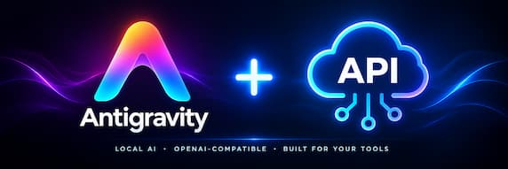

<p align="center">
  
</p>

# Antigravity Local API + Memory Bridge

**Author & Creator:** Rishabh Raj ([@rishu7491](https://github.com/rishu7491))  
**License:** Private / Proprietary  

OpenAI-compatible local HTTP bridge for the AGY CLI, with a local searchable archive of conversations and an MCP server that lets AGY search that archive as a tool.

## Requirements

- Node.js 22.5+ (tested with Node 24.21.0; uses built-in `node:sqlite` and `process.loadEnvFile`).
- The AGY CLI installed and signed in. By default, the API expects it at `~/.local/bin/agy`.
- No third-party npm dependencies are required.
- SQLite FTS5 must be available in the Node SQLite build.

## Quick setup

1. Open a terminal in the project directory.
2. Create your local configuration file from the template:

   Windows PowerShell:
   ```powershell
   Copy-Item .env.example .env
   ```

3. Open `.env` and change settings as needed.
4. Start the API:
   ```bash
   npm start
   ```

The server listens at `http://127.0.0.1:8788`.

## Memory HTTP Endpoints

- `GET /v1/memory/stats` — index and archive counts.
- `GET /v1/memory/dates` — dates containing archived messages.
- `POST /v1/memory/search` — global full-text search.
- `POST /v1/memory/grep` — literal substring search.
- `POST /v1/memory/read` — read a matching message plus nearby messages.
- `POST /v1/memory/ingest` — import a conversation.

## Register memory tools for AGY

```bash
agy mcp add --type stdio agy-memory "$(command -v node)" "$PWD/memory-mcp.mjs"
agy mcp list
```
